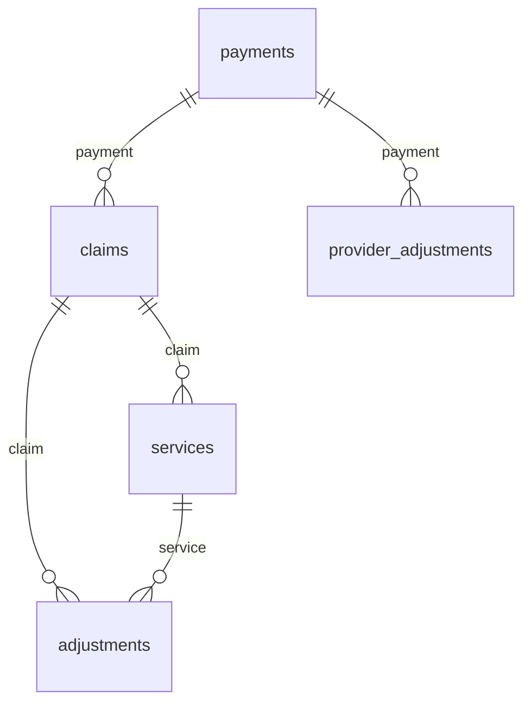

# Tables and columns

oxedi reads every 835 into the same five tables. This page shows how they link and lists every
column, with its type, the element it comes from and what it holds.

New to the 835? [The 835 in five minutes](../start/the-835.md) explains payments, claims and
adjustments first.

## How the tables link



- `row` numbers the rows of a table, from 0.
- `payment`, `claim` and `service` hold the `row` of the parent.
- A service joins to its claim on `services.claim = claims.row`.
- An adjustment of a claim has a null `service`. An adjustment of a service line has the
  line's `row` in `service`.
- Children also carry the `row` of every table above them. A service has both `claim` and
  `payment`.

!!! note "Several files"
    Row numbers restart in every file. When you combine files, join on the file name as well
    as the row. The [Polars](../recipes/polars.md) and [lakehouse](../recipes/lakehouse.md)
    recipes show how.

??? note "Details: row numbers in one file"
    `row` counts across the whole file, not per transaction. In a file with two payments, the
    claims of the second payment carry on from the last claim of the first.

## Columns every table has

| Column | Type | Holds |
|---|---|---|
| `row` | int64 | The row's number in its table, from 0. |
| `segment` | int64 | The index of the segment the row starts at: its `CLP` for a claim, its `CAS` for an adjustment. `result.document[segment]` gives that segment. |
| `payment` | int64 | The `row` of the payment the row belongs to. Not in `payments`. |
| `claim` | int64 | The `row` of the claim. In `services` and `adjustments`. |
| `service` | int64 | The `row` of the service line, or null for a claim adjustment. In `adjustments`. |

The tables list these columns first and the others in name order.

## Types

| Type here | Python (Arrow) | Polars | DuckDB |
|---|---|---|---|
| text | `binary` | `Binary` | `VARCHAR` (`BLOB` with `binary := true`) |
| decimal(38, 2) | `decimal128(38, 2)` | `Decimal(38, 2)` | `DECIMAL(38,2)` |
| decimal(38, 4) | `decimal128(38, 4)` | `Decimal(38, 4)` | `DECIMAL(38,4)` |
| date | `date32` | `Date` | `DATE` |
| int64 | `int64` | `Int64` | `BIGINT` |

- Text keeps the bytes of the file. Cast to a string type to read or group by it.
- A text element the segment does not have is null. One it has but leaves empty is `""`.
- In the other types, a value that is missing, empty or does not parse is null. The parse
  reports a value that does not parse as a diagnostic.

## How to read the source column

- `BPR02` is element 2 of the `BPR` segment.
- `SVC01-2` is component 2 of element 1 of `SVC`.
- `of NM1*QC` means the `NM1` segment whose first element is `QC`. A claim has several `NM1`
  segments, and this one is the patient.
- When a segment repeats where the table reads it, the column takes the first one.

The [glossary](glossary.md) explains each segment id. The spec defines all of this, and you can
change it: see [Customizing the spec](../customize/spec.md).

## payments

One row per payment, which is one transaction (`ST` to `SE`). The payer is loop `1000A` and the
payee loop `1000B`.

| Column | Type | Source | Holds |
|---|---|---|---|
| `handling_code` | text | `BPR01` | The transaction handling code. |
| `total_payment_amount` | decimal(38, 2) | `BPR02` | The total actual payment to the provider. |
| `credit_debit_flag` | text | `BPR03` | Whether the amount is a credit (`C`) or a debit (`D`). |
| `payment_method` | text | `BPR04` | The payment method code, such as `CHK` or `ACH`. |
| `payment_format` | text | `BPR05` | The payment format code. |
| `payment_date` | date | `BPR16` | The check issue date or the EFT effective date. |
| `trace_number` | text | `TRN02` | The check or EFT trace number. |
| `payer_identifier` | text | `TRN03` | The payer identifier of the trace. |
| `receiver_id` | text | `REF02` of `REF*EV` | The receiver identification. |
| `production_date` | date | `DTM02` of `DTM*405` | The production date. |
| `payer_name` | text | `N102` of `N1*PR` | The payer's name. |
| `payer_id_qualifier` | text | `N103` of `N1*PR` | The kind of id in `payer_id`. |
| `payer_id` | text | `N104` of `N1*PR` | The payer's identification code. |
| `payer_address` | text | `N301` in loop `1000A` | The payer's address. |
| `payer_city` | text | `N401` in loop `1000A` | The payer's city. |
| `payer_state` | text | `N402` in loop `1000A` | The payer's state or province code. |
| `payer_zip` | text | `N403` in loop `1000A` | The payer's postal code. |
| `payer_technical_contact_name` | text | `PER02` of `PER*BL` | The name of the payer's technical contact. |
| `payer_technical_contact_qualifier` | text | `PER03` of `PER*BL` | The kind of number in `payer_technical_contact_number`. |
| `payer_technical_contact_number` | text | `PER04` of `PER*BL` | The technical contact's communication number. |
| `payee_name` | text | `N102` of `N1*PE` | The payee's name. |
| `payee_id_qualifier` | text | `N103` of `N1*PE` | The kind of id in `payee_id`. |
| `payee_id` | text | `N104` of `N1*PE` | The payee's identification code. |
| `payee_address` | text | `N301` in loop `1000B` | The payee's address. |
| `payee_city` | text | `N401` in loop `1000B` | The payee's city. |
| `payee_state` | text | `N402` in loop `1000B` | The payee's state or province code. |
| `payee_zip` | text | `N403` in loop `1000B` | The payee's postal code. |

!!! note "4010 files"
    The `payer_technical_contact_*` columns are null on 4010 files.

## claims

One row per claim (`CLP`, loop `2100`).

| Column | Type | Source | Holds |
|---|---|---|---|
| `claim_id` | text | `CLP01` | The claim submitter's identifier: the provider's id for the claim. |
| `claim_status` | text | `CLP02` | The claim status code. See [claim status](glossary.md#claim-status). |
| `charge_amount` | decimal(38, 2) | `CLP03` | The total charge of the claim. |
| `payment_amount` | decimal(38, 2) | `CLP04` | The amount paid for the claim. |
| `patient_responsibility` | decimal(38, 2) | `CLP05` | The patient responsibility amount. |
| `filing_indicator` | text | `CLP06` | The claim filing indicator code. |
| `payer_control_number` | text | `CLP07` | The payer's claim control number. |
| `facility_type` | text | `CLP08` | The facility type code. |
| `frequency_code` | text | `CLP09` | The claim frequency type code. |
| `drg_code` | text | `CLP11` | The DRG code. |
| `drg_weight` | decimal(38, 4) | `CLP12` | The DRG weight. |
| `discharge_fraction` | decimal(38, 4) | `CLP13` | The discharge fraction. |
| `header_number` | int64 | `LX01` | The number of the `LX` group (loop `2000`) the claim is in. |
| `patient_last_name` | text | `NM103` of `NM1*QC` | The patient's last name. |
| `patient_first_name` | text | `NM104` of `NM1*QC` | The patient's first name. |
| `patient_id_qualifier` | text | `NM108` of `NM1*QC` | The kind of id in `patient_id`. |
| `patient_id` | text | `NM109` of `NM1*QC` | The patient's identification code. |
| `rendering_provider_entity_type` | text | `NM102` of `NM1*82` | The entity type qualifier of the service provider. |
| `rendering_provider_name` | text | `NM103` of `NM1*82` | The service provider's last or organization name. |
| `rendering_provider_id_qualifier` | text | `NM108` of `NM1*82` | The kind of id in `rendering_provider_id`. |
| `rendering_provider_id` | text | `NM109` of `NM1*82` | The service provider's identification code. |
| `statement_from` | date | `DTM02` of `DTM*232` | The first date of the claim's statement period. |
| `statement_to` | date | `DTM02` of `DTM*233` | The last date of the claim's statement period. |
| `coverage_amount` | decimal(38, 2) | `AMT02` of `AMT*AU` | The coverage amount. |
| `group_number` | text | `REF02` of `REF*1L` | The group number. |

## services

One row per service line (`SVC`, loop `2110`).

| Column | Type | Source | Holds |
|---|---|---|---|
| `procedure_qualifier` | text | `SVC01-1` | The kind of code in `procedure_code`, such as `HC`. |
| `procedure_code` | text | `SVC01-2` | The procedure or service code. |
| `charge_amount` | decimal(38, 2) | `SVC02` | The line item charge. |
| `payment_amount` | decimal(38, 2) | `SVC03` | The amount paid for the line. |
| `units_paid` | decimal(38, 2) | `SVC05` | The units of service paid. |
| `original_units` | decimal(38, 2) | `SVC07` | The original units of service. |
| `service_date` | date | `DTM02` of `DTM*472` | The service date. |
| `line_item_control_number` | text | `REF02` of `REF*6R` | The line item control number. |
| `allowed_amount` | decimal(38, 2) | `AMT02` of `AMT*B6` | The allowed amount. |

## adjustments

One row per adjustment. A `CAS` segment holds up to six adjustments of one group: the reason,
amount and quantity of each sit in three elements in a row. Each becomes its own row.

| Column | Type | Source | Holds |
|---|---|---|---|
| `group_code` | text | `CAS01` | The claim adjustment group code, such as `CO` or `PR`. See [group code](glossary.md#group-code). |
| `reason_code` | text | `CAS02`, `CAS05`, … | The adjustment reason code (a [CARC](glossary.md#carc)). |
| `amount` | decimal(38, 2) | `CAS03`, `CAS06`, … | The adjustment amount. |
| `quantity` | decimal(38, 2) | `CAS04`, `CAS07`, … | The adjustment quantity. |

## provider_adjustments

One row per provider adjustment. A `PLB` segment holds up to six adjustments for one provider
and fiscal period: an identifier and an amount each. Each becomes its own row.

| Column | Type | Source | Holds |
|---|---|---|---|
| `provider_id` | text | `PLB01` | The provider identifier. |
| `fiscal_period_date` | date | `PLB02` | The fiscal period date. |
| `reason_code` | text | `PLB03-1`, `PLB05-1`, … | The provider adjustment reason code. |
| `reference_id` | text | `PLB03-2`, `PLB05-2`, … | The reference identification of the adjustment. |
| `amount` | decimal(38, 2) | `PLB04`, `PLB06`, … | The provider adjustment amount. |

Adjustments that share a `segment` came from the same `PLB`. The writer keeps them together, as
[Writing from your own tables](../python/own-tables.md) explains.

## diagnostics (DuckDB only)

In DuckDB, `read_835(..., table_name := 'diagnostics')` returns the findings of the parse as a
sixth table, one row per finding:

| Column | Type | Holds |
|---|---|---|
| `level` | `BIGINT` | The SNIP level of the rule: 1, 2 or 3. |
| `kind` | `VARCHAR` | The name of the rule, such as `CodeNotInList`. |
| `rule` | `VARCHAR` | The rule as a sentence with its values. |
| `segment` | `BIGINT` | The index of the segment at fault. |
| `element`, `component` | `BIGINT` | The 1-based position in the segment, when there is one. |
| `path` | `VARCHAR` | The loops open at that segment. |
| `datum` | `VARCHAR` | The offending value. |
| `origin`, `code` | `VARCHAR` | Who reported it, and that reporter's own code. |

In Python the same fields are on each `oxedi.Diagnostic`. See
[Diagnostics](../python/diagnostics.md).

## See the columns of any table

The spec decides the columns, so a patched spec can add some. To list them:

=== "Python"

    ```python
    import oxedi

    result = oxedi.parse_file("remittance.835")
    print(result.tables["services"].columns)
    ```

    ```text
    ['row', 'segment', 'payment', 'claim', 'allowed_amount', 'charge_amount', 'line_item_control_number', 'original_units', 'payment_amount', 'procedure_code', 'procedure_qualifier', 'service_date', 'units_paid']
    ```

=== "SQL"

    ```sql
    DESCRIBE SELECT * FROM read_835('remittance.835', table_name := 'services');
    ```

A schema that does not need a file is tracked in
[#138](https://github.com/javillegasna/oxedi/issues/138).
