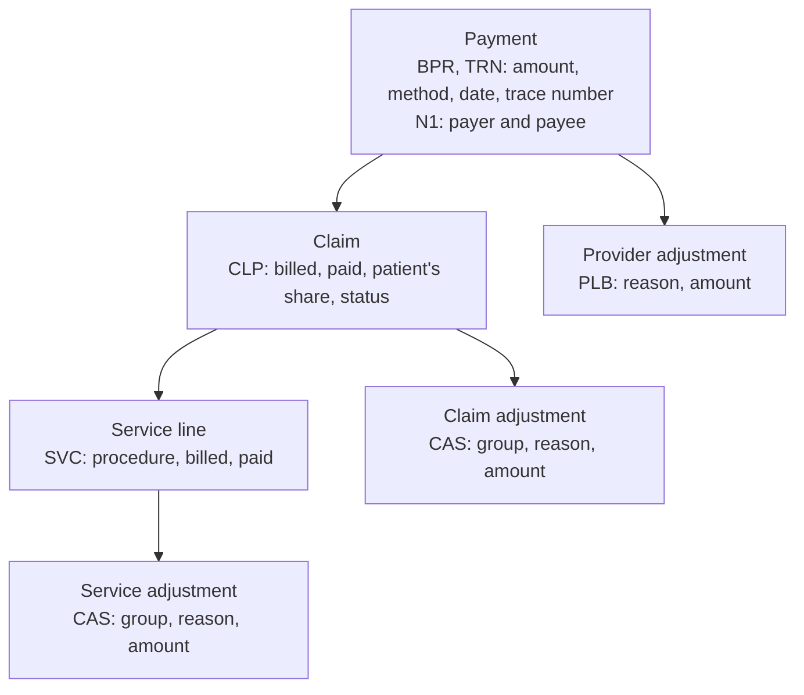

# The 835 in five minutes

This page explains what an 835 file is, how it is built and how oxedi turns it into tables.
You do not need to know X12 to follow it. The [glossary](../reference/glossary.md) defines
every term.

## What an 835 is

A provider (a clinic, a hospital, a doctor) sends claims to a health plan to be paid for the
care it gave. The health plan pays, usually in one payment that covers many claims. The 835
tells the provider what that payment covers.

- Its full name is the X12 835 Health Care Claim Payment/Advice. It is also called an
  electronic remittance advice (ERA).
- The **payer** (the health plan) sends it. The **payee** (the provider) receives it.
- The money itself moves separately, by check or by electronic funds transfer (EFT). The 835
  carries a trace number so the provider can match the file to the money.
- For each claim it says what was billed, what was paid and why the two differ.

oxedi reads the 5010 version of the format (`005010X221A1`) and the older 4010 version
(`004010X091A1`).

## How a payment breaks down

An 835 nests from the payment down to single adjustments:



- **Payment.** One per transaction. It holds the total paid, how and when, and who pays whom.
- **Claim.** One per claim the provider sent. A payment covers one or more claims.
- **Service line.** One per procedure or service billed on the claim. A claim may have none.
- **Adjustment.** A reason why the paid amount differs from the billed one. It sits on a claim
  or on one of its service lines.
- **Provider adjustment.** An amount added to or taken from the whole payment, not from one
  claim.

The money balances at every level. A service line's billed amount minus its paid amount equals
the sum of its adjustments. A claim's billed minus paid equals the sum of its own adjustments
and those of its service lines. The payment's total equals the
claims' payments minus the provider adjustments. oxedi checks these rules and reports a
diagnostic when one fails.

## How oxedi maps it to tables

Each level becomes one table. Each row points to its parent by the parent's row number.

| Table | One row per | Points to its parent with |
|---|---|---|
| `payments` | payment | none |
| `claims` | claim | `payment` |
| `services` | service line | `payment`, `claim` |
| `adjustments` | claim or service adjustment | `payment`, `claim`, `service` (empty on a claim adjustment) |
| `provider_adjustments` | provider adjustment | `payment` |

[Tables and columns](../reference/tables.md) shows every column and the element it comes from.

## What the file looks like

An 835 is plain text. Each line here is a **segment**, ending with `~`. The first word is the
segment's id. The values after it are its **elements**, separated by `*`. Some elements hold
**components**, separated by `:`.

This is part of the example file of [Get started](index.md), from the start of the
transaction to the first service line:

```text
ST*835*0001*005010X221A1~
BPR*I*690*C*CHK************20240112~
TRN*1*CHK100234*1512345678~
REF*EV*RECV0001~
DTM*405*20240110~
N1*PR*ACME HEALTH PLAN~
N3*100 MAIN ST~
N4*SPRINGFIELD*IL*62701~
PER*CX*CLAIMS DEPT*TE*8005551234~
PER*BL*EDI SUPPORT*TE*8005559876*EM*edi@example.com~
N1*PE*SUNRISE CLINIC*XX*1234567893~
N3*200 OAK AVE~
N4*SPRINGFIELD*IL*62702~
REF*TJ*371234567~
LX*1~
CLP*CLM1001*1*300*200*60*12*PCN1001*11*1~
NM1*QC*1*DOE*JANE****MI*MBR0001~
NM1*82*1*SMITH*JOHN****XX*1234567893~
REF*1L*GRP77~
DTM*232*20240105~
DTM*233*20240105~
AMT*AU*250~
SVC*HC:99213*200*150**1~
DTM*472*20240105~
CAS*PR*1*30~
CAS*CO*45*20~
REF*6R*LINE0001~
AMT*B6*180~
```

| Segment | What it says | Where it lands |
|---|---|---|
| `ST*835*0001*…` | A transaction of type 835 starts. | Opens a row of `payments` |
| `BPR*I*690*C*CHK…*20240112` | 690.00 paid by check (`CHK`), dated 2024-01-12. | `total_payment_amount`, `payment_method`, `payment_date` |
| `TRN*1*CHK100234*1512345678` | The trace number that matches the money. | `trace_number`, `payer_identifier` |
| `N1*PR*ACME HEALTH PLAN` | The payer (`PR`), with its address in `N3` and `N4`. | `payer_name`, `payer_address`, `payer_city`, … |
| `N1*PE*SUNRISE CLINIC*XX*1234567893` | The payee (`PE`), with its id and the id's qualifier `XX`. | `payee_name`, `payee_id_qualifier`, `payee_id` |
| `LX*1` | A group of claims starts. | `header_number` of each claim |
| `CLP*CLM1001*1*300*200*60…` | Claim CLM1001, status `1`: billed 300, paid 200, patient owes 60. | A row of `claims` |
| `NM1*QC*1*DOE*JANE…*MI*MBR0001` | The patient (`QC`) and the patient's member id. | `patient_last_name`, `patient_first_name`, `patient_id` |
| `DTM*232*20240105` | The claim's statement period starts (`232`). | `statement_from` |
| `SVC*HC:99213*200*150**1` | A service line: procedure 99213 (qualifier `HC`), billed 200, paid 150, 1 unit paid. | A row of `services` |
| `CAS*PR*1*30` | An adjustment of the service: group `PR`, reason `1`, 30.00. | A row of `adjustments` |
| `AMT*B6*180` | The allowed amount of the service line. | `allowed_amount` |

The envelope wraps the transaction. `ISA` and `GS` come before `ST`. `SE`, `GE` and `IEA` close
them in reverse order. They carry who sent the file, when, and the counts and control numbers
that let the receiver check nothing is missing.

## Loops

The implementation guide groups segments into **loops**, named by number. oxedi uses those
names in diagnostics and in the spec:

| Loop | Starts with | Holds |
|---|---|---|
| `1000A` | `N1*PR` | the payer |
| `1000B` | `N1*PE` | the payee |
| `2000` | `LX` | a group of claims |
| `2100` | `CLP` | one claim |
| `2110` | `SVC` | one service line |

`PLB` and the payment segments (`BPR`, `TRN`) belong to the transaction itself, outside any
numbered loop.

## Next

- [Get started](index.md): parse the example file yourself.
- [Tables and columns](../reference/tables.md): every column and its source.
- [Glossary](../reference/glossary.md): the terms and segment ids.
